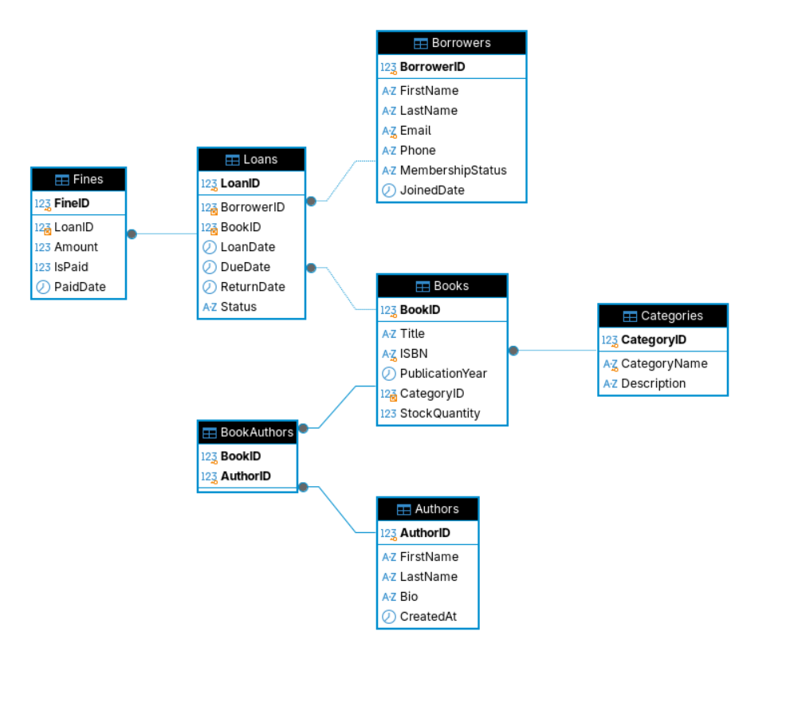

# MIT 8103 – Advanced Database Systems

## Continuous Assessment Portfolio – Final Documentation

**Student Name:** Samuel Ochie  
**Student ID:** 301930377

---

## 1. Selected Case Study / Organization

This portfolio uses a single consistent case study: a **Library Management System** for a public or university library.

**Nature of the system:** A digital platform that manages physical book inventory, member accounts, circulation (loans and returns), and overdue fines.

**Users of the database:** Borrowers (students/members) who search the catalogue and view loans/fines; Librarians/staff who process check-outs, check-ins and memberships; and System administrators who manage performance and integrity.

**Major data stored:** Books (ISBN, title, stock, category), Authors, Categories, Borrowers (contact details, membership status), Loans (dates, status), and Fines.

*Figure 1: ER Diagram of Database*

**Key operations supported:** Catalogue search, member registration, book borrowing and return, automatic fine calculation, and analytical reporting on circulation and overdue items.

The same case study is applied consistently across all five portfolio activities and the distributed architecture exercise.

## 2. GitHub Repository

All practical evidence (SQL scripts, schema files, ER diagrams, MongoDB scripts, Docker configuration, execution plans, screenshots and technical READMEs) is maintained in a private GitHub repository:

[https://github.com/Fritzgerrad/advanced-database-portfolio](https://github.com/Fritzgerrad/advanced-database-portfolio)

The repository follows the recommended structure (`portfolio-1-database-design` through `portfolio-5-distributed-cloud`) and contains progressive commits demonstrating continuous development throughout the assessment period. Access has been granted to the assessor.

## 3. Summary of Portfolio Activities

### Portfolio 1 – Database Design and Modelling

A fully normalized relational schema (3NF) was designed for the Library Management System. Entities include Categories, Authors, Books, BookAuthors (junction), Borrowers, Loans and Fines. Primary keys, foreign keys with appropriate cascade/restrict actions, UNIQUE constraints, CHECK constraints (e.g. non-negative stock) and ENUM types for status fields were defined. An ER diagram was produced and constraint-violation tests were executed and captured. Deliberate denormalization of a small number of columns (loan status, fine amount, stock quantity) was documented and justified for performance and historical accuracy.

### Portfolio 2 – Query Processing and Optimization

Three analytical queries were written (overdue loans with unpaid fines, category popularity and circulation, borrower loan history). A bulk data set of approximately 20,000 books, 5,000 borrowers and 100,000 loans was generated. Baseline and post-index execution plans were captured using `ANALYZE`/`EXPLAIN`. Composite indexes (notably on Loans status and due date) reduced rows examined and improved response time. Before-and-after plans, index definitions and result screenshots are included in the repository.

### Portfolio 3 – Transactions and Concurrency

A stored procedure (`sp_CheckoutBook`) was developed to manage book checkouts using transactions, including stock verification, loan insertion and stock updates. COMMIT and ROLLBACK operations were demonstrated. A two-session concurrency experiment reproduced a lost-update anomaly under READ COMMITTED, which was prevented using `SELECT ... FOR UPDATE`. The results demonstrated how pessimistic locking helps maintain data consistency during concurrent transactions.

### Portfolio 4 – NoSQL and Advanced Data Models

The same library domain was remodeled as MongoDB documents. Borrower documents embed an array of loans, each optionally containing an embedded fine; book documents embed category and authors. `$jsonSchema` validators, unique indexes and a multikey index on loan status were applied. Operations demonstrated include nested-array queries for overdue loans, positional updates, `$unwind`/`$group` aggregations, `$lookup` across collections, and explain plans confirming index use. Suitability of the document model for read-heavy catalogue and history views was discussed against the normalized relational design.

### Portfolio 5 – Distributed and Cloud Database Exercise

A primary–replica architecture was deployed using Docker Compose with MariaDB 10.11. Binary logging and asynchronous replication were configured. Writes performed on the primary were verified on the replica. Primary failure was simulated; the replica continued to serve reads and was manually promoted to accept writes. Screenshots of container health, master/slave status, write and read tests, failure and promotion are provided. Sharding considerations for a multi-campus scenario were discussed conceptually.

## 4. Individual Technical Reflection

Working through the five portfolio activities on a single consistent case study clarified the practical trade-offs that appear in real systems. The relational design prioritizes integrity and supports complex multi-table transactions; the document model simplifies common read paths at the cost of some update complexity and potential data duplication. Indexing only became meaningful once a realistically large data set was loaded—small sample data hid the benefit of the composite status/due-date index.

The concurrency exercise was particularly instructive: the lost-update anomaly is easy to describe in theory but only becomes tangible when two sessions are stepped through side-by-side. Seeing the stock quantity become incorrect under READ COMMITTED and then remain correct under FOR UPDATE reinforced why isolation levels and explicit locking matter for inventory-style workloads.

Building a working primary–replica pair with Docker exposed operational realities (configuration files, replication user privileges, consistent snapshot initialization, and the need for manual promotion in a simple setup). The main challenge was ensuring the replica initialization used a consistent view of the primary; once that was solved, write-to-primary / read-from-replica behavior and failover demonstration proceeded cleanly.

Overall, the portfolio moved the focus from isolated concepts to an integrated view of design, performance, correctness under concurrency, alternative data models, and distribution. Future improvements would include automated failover, a more complete set of stored procedures for business operations, and quantitative load testing of the replica under concurrent read traffic.

## 5. AI Use Declaration

AI tools (including large language models) were used as learning and productivity aids during the development of this portfolio. Specifically:

- **Tool used:** ChatGPT, Gemini and Claude.
- **Purpose:** Assistance with structuring documentation, clarifying SQL/MongoDB syntax, reviewing normalization explanations, and drafting reflective text.
- **Review and verification:** All generated schema definitions, scripts, queries, Docker configurations and explanations were examined, tested against the running MariaDB and MongoDB instances, corrected where necessary, and executed by me. Screenshots and execution plans are the direct result of my own test runs. I remain fully responsible for the accuracy, originality and understanding of every submitted artefact.

## 6. References

- MariaDB Foundation. *MariaDB Server Documentation: Replication and Binary Logging.*  
  https://mariadb.com/kb/en/replication/
- MongoDB, Inc. *MongoDB Manual: Documents, Aggregation and Indexes.*  
  https://www.mongodb.com/docs/manual/
- Docker, Inc. *Docker Compose Documentation.*  
  https://docs.docker.com/

---

All practical evidence, scripts, configuration files and screenshots supporting the summaries above are available in the GitHub repository linked in Section 2.
