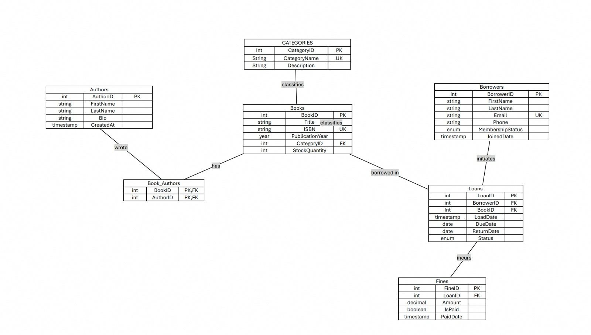

# Entity-Relationship (ER) Diagram
**Case Study:** Library Management System  
**Student Name:** Samuel Ochie (ID: 301930377)  

---

## 1. Visual ER Diagram

---

## 2. Structural Relationships and Cardinalities

### 1. Categories to Books
* **Cardinality:** `1 : N` (One-to-Many)
* **Description:** A single category classifies zero or many books. Each book must belong to exactly one category (`CategoryID` foreign key in `Books`).

### 2. Books to Authors (via BookAuthors)
* **Cardinality:** `M : N` (Many-to-Many)
* **Description:** A book can be co-authored by multiple authors, and an author can write multiple books. This is resolved via the `BookAuthors` junction entity with a composite primary key (`BookID`, `AuthorID`).

### 3. Borrowers to Loans
* **Cardinality:** `1 : N` (One-to-Many)
* **Description:** A registered borrower can initiate zero or many loan transactions over time. Every loan record must reference an existing borrower (`BorrowerID` foreign key in `Loans`).

### 4. Books to Loans
* **Cardinality:** `1 : N` (One-to-Many)
* **Description:** A single book title in inventory can be borrowed across multiple loan entries over time (`BookID` foreign key in `Loans`).

### 5. Loans to Fines
* **Cardinality:** `1 : 0..1` (One-to-Zero-or-One)
* **Description:** A loan transaction incurs at most one fine penalty if returned past the designated `DueDate`. Every fine record links back to a specific loan transaction (`LoanID` foreign key in `Fines`).

