# Portfolio 2: Query Processing and Optimisation

## 1. Overview
This module writes analytical queries for the Library Management System, reads their execution plans with `EXPLAIN`, adds indexes that are justified by those plans, and measures the effect on a realistically sized data set.

| File | Purpose |
|---|---|
| `Ochie_Samuel_P2_Queries.sql` | Three reporting queries (overdue report, category popularity, borrower history) |
| `Ochie_Samuel_BulkData.sql` | Generates 5,000 borrowers, 20,000 books, 100,000 loans and ~50,000 fines |
| `Ochie_Samuel_P2_Optimisation.sql` | Baseline plans, index creation, after-plans, index size/cost |

**Run order:** `Schema.sql` → `SampleData.sql` → `BulkData.sql` → `Queries.sql` → `Optimisation.sql` (Portfolio 1 scripts first).

---

## 2. Analytical queries
1. **Overdue report:** joins `Borrowers`, `Loans`, `Books` and `Fines` for overdue loans with an unpaid fine and computes `DaysOverdue` with `DATEDIFF`.
2. **Category popularity:** counts loans per category and shows current stock per category.
3. **Borrower history:** lifetime loans and currently open loans per member.

---

## 3. Execution Plan (using `ANALYZE`)

Each query was run with `ANALYZE` on MariaDB before and after the indexes were created, on a data set of about 100,000 loans, 20,000 books and 50,000 fines. `ANALYZE` returns the optimiser's estimated rows (`rows`) and the rows actually read (`r_rows`). Execution times are also noted, however, times of a few milliseconds vary from run to run, so only large differences are treated as real.

---

## 4. Query Results
Execution output for member borrowing summaries and category metrics aptured directly within DBeaver.

#### Active Borrowers
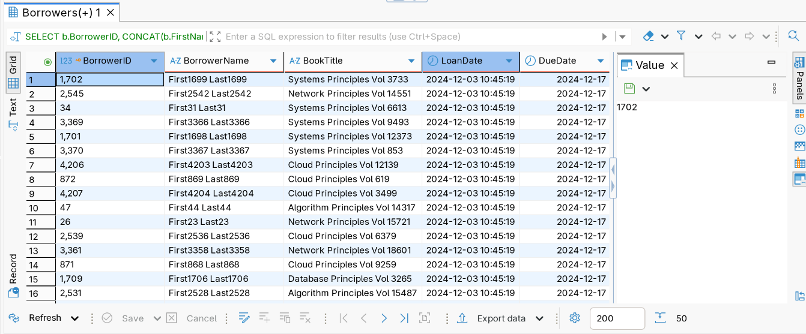

#### Borrowers Loan History
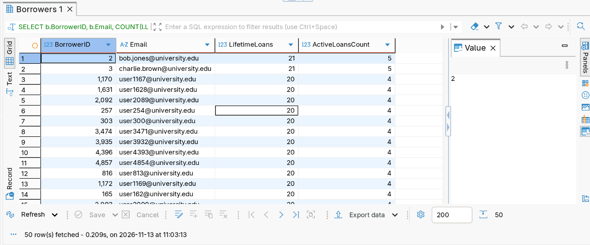

#### Bulk Data
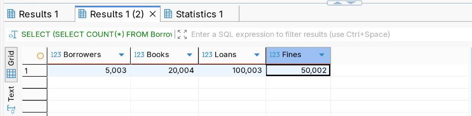

#### Category Popularity and Circulation Aggregation: Total loans per book.
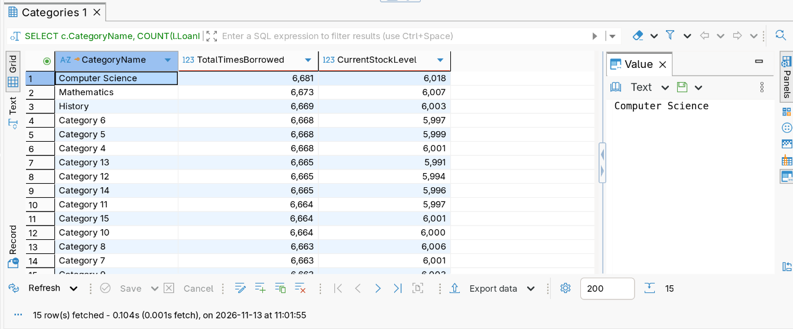

## 5. Performance Analysis

### 5.1 Summary of findings
1. **The biggest gain came from a composite index that matched the query.** `idx_loans_status_due (Status, DueDate)` puts the equality column first and the range column second, and it also covers the query. Rows read fell from about 100,000 to 9,711 and time from 27 ms to 5 ms.
2. **A prefix search benefits, a contains search does not.** `LIKE 'Database%'` can use a B-tree range, but `LIKE '%Principles%'` cannot. For real word search on titles, a `FULLTEXT` index would be the correct tool.
3. **An extra index is not automatically useful.** `BorrowerID` was already indexed by the foreign key, so the composite `(BorrowerID, Status)` index changed the estimated rows from 20 to 2 but not the time. If write cost matters more than this lookup, it is a candidate to drop.
4. **Low-selectivity columns are poor index candidates.** About 20% of fines are unpaid, so an index on `IsPaid` would not help; the plan for Q-F was left unchanged.
5. **Primary keys, `UNIQUE` constraints and foreign keys already create indexes.** That is why the baseline for Q-D was `ref` and Q-E was `const` before I added anything.

### 5.2 Indexes created
`CREATE INDEX idx_loans_status_due ON Loans (Status, DueDate);`  
`CREATE INDEX idx_books_title ON Books (Title);`  
`CREATE INDEX idx_loans_borrower_status ON Loans (BorrowerID, Status);`

(Existing indexes before and after are shown in the screenshots below.)

#### Default Indexes
- ##### Books
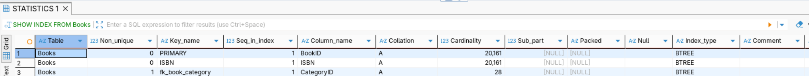
- ##### Loan
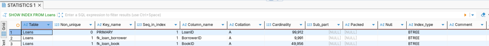
- ##### Fines
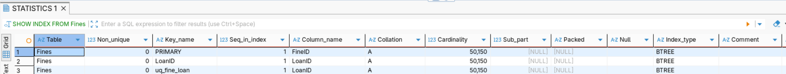

#### Indexes Created
- ##### Books
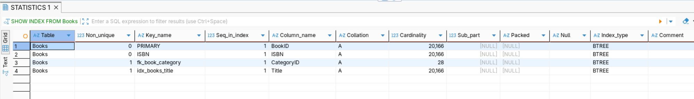
- ##### Loans
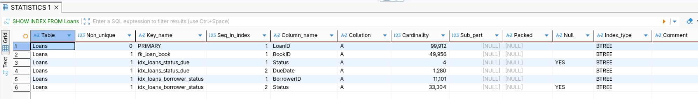
- ##### Fines
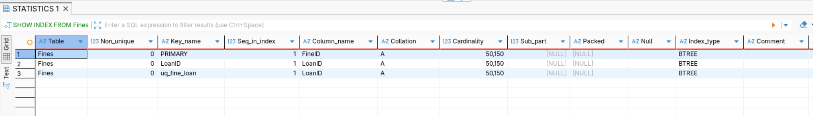

| Index | Query it serves | Reasoning |
|---|---|---|
| `idx_loans_status_due (Status, DueDate)` | Q-A: overdue more than 30 days | Equality column (`Status`) first, range column (`DueDate`) second; also covers the query (no table lookup) |
| `idx_books_title (Title)` | Q-B: `Title LIKE 'Database%'` | A B-tree supports prefix searches as a range scan |
| `idx_loans_borrower_status (BorrowerID, Status)` | Q-D: one member's open loans | Both predicates resolved in the index; expected to be a small gain only, because `BorrowerID` was already indexed |

The screenshot below shows the cost side. On `Loans` the indexes take 7.55 MB against 4.52 MB of table data, and on `Books` 3.53 MB against 2.52 MB. These figures include the primary-key and foreign-key indexes as well as the three I added. Every insert, update or delete on these tables must also maintain each index, so indexes speed reads at the cost of space and write time.

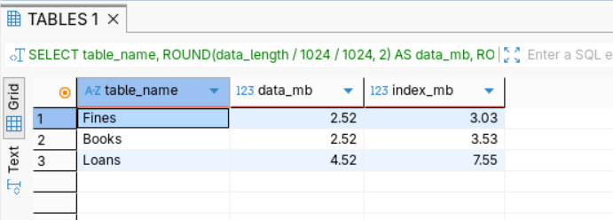

### 5.3 Results before and after Indexes were created for Optimization
Below shows the results of `ANALYZE` (actual rows and time), before and after the index, three runs each, median recorded. Performance benchmarks shows reduced execution overhead.

**Query A** (`ANALYZE SELECT COUNT(*) FROM Loans WHERE Status = 'Overdue' AND DueDate < CURRENT_DATE - INTERVAL 30 DAY;`)

##### Before Indexes were created:
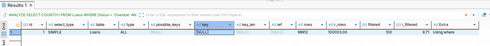

##### After Indexes were created: 
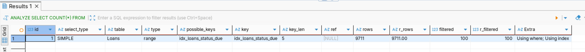

---
---

**Query B** (`ANALYZE SELECT BookID, Title FROM Books WHERE Title LIKE 'Database%';`)

##### Before Indexes were created:

##### After Indexes were created: 
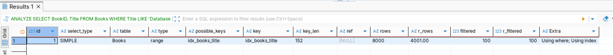

---
---

**Query C** (`ANALYZE SELECT BookID, Title FROM Books WHERE Title LIKE '%Principles%';`)

##### Before Indexes were created:
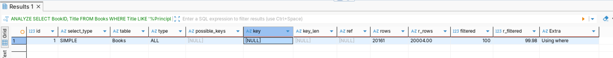

##### After Indexes were created: 
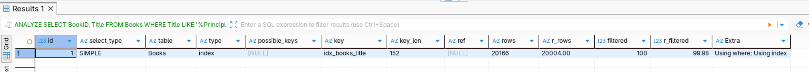

---
---

**Query D** (`ANALYZE SELECT * FROM Loans WHERE BorrowerID = 1234 AND Status = 'Borrowed';`)

##### Before Indexes were created:
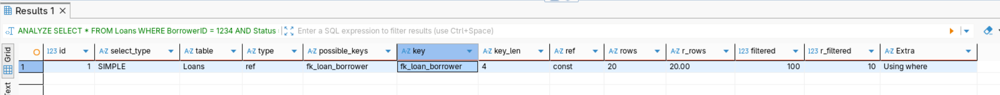

##### After Indexes were created: 
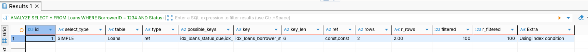

---
---

**Query E** (`ANALYZE SELECT * FROM Books WHERE ISBN = '9780001000100';`)

##### Before Indexes were created:
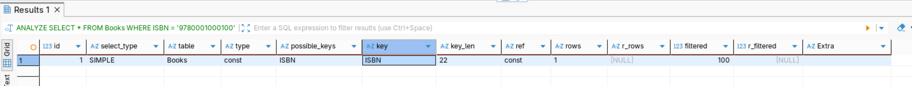

##### After Indexes were created: 
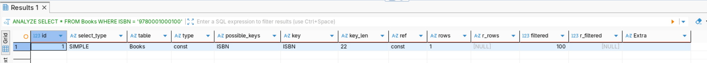

---
---

**Query F** (`ANALYZE SELECT l.BorrowerID, SUM(f.Amount) AS UnpaidTotal FROM Fines f JOIN Loans l ON l.LoanID = f.LoanID WHERE f.IsPaid = FALSE GROUP BY l.BorrowerID;`)

##### Before Indexes were created:
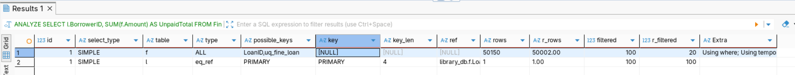

##### After Indexes were created: 
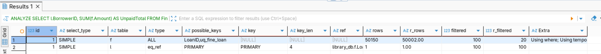

---

### 5.4 Results Summary

| Query | Before: type / key / rows | Before: time (ms) | After: type / key / rows | After: time (ms) |
|---|---|---|---|---|
| Q-A overdue > 30 days | ALL / NULL / 99912 |27 | range / idx_loans_status_due / 9711| 5 |
| Q-B title prefix |ALL / NULL / 20166 | 9 | range / idx_books_title / 8000 | 3 |
| Q-C title `%word%` (control) | ALL / NULL / 20166 | 11 | index / idx_books_title / 20161| 2 |
| Q-D member's open loans | ref / fk_loan_borrower / 20 | 2 | ref / idx_loans_borrower_status / 2 | 2 |
| Q-E ISBN lookup (control) | const / ISBN / 1 | 2 | const / ISBN / 1 | 1 |
| Q-F unpaid fines | ALL,eq_ref / NULL, PRIMARY / 50150, 1 | 39 | ALL, eq_ref / NULL, PRIMARY / 50150, 1 | 35 |

---

* **Q-A (overdue more than 30 days):** `ALL` with no key, 99,912 estimated rows (100,003 actually read), became `range` on `idx_loans_status_due` with 9,711 rows. The `Using index` note means the index alone answered the query without reading the table. Time fell from 27 ms to 5 ms.
* **Q-B (title prefix):** `ALL` over 20,166 rows became `range` on `idx_books_title`; about 4,001 rows were actually read. Time fell from 9 ms to 3 ms.
* **Q-C (title contains a word):** this was meant as a control that could not use an index, and the result shows why that assumption was incomplete. The leading `%` still rules out a range lookup, but the optimiser chose `type = index`: a full scan of `idx_books_title` (20,004 rows read). It did this because the index holds both columns the query needs (`Title` and the primary key `BookID`), so the smaller index can be read instead of the whole table. This is a covering index scan, not a selective lookup, which is why it only saved time (11 ms to 2 ms), not rows.
* **Q-D (one member's open loans):** it was already `ref` through the foreign-key index. The composite index reduced the estimate from 20 rows to 2 but made no measurable difference to time.
* **Q-E (ISBN lookup):** `const` before and after. `ISBN` is `UNIQUE`, so an index already existed and none was added.
* **Q-F (unpaid fines per borrower):** the plan did not change. `Fines` is read in full (about 50,150 rows) and joined to `Loans` by primary key. About 20% of fines are unpaid (`r_filtered` = 20), which is too many for an index on `IsPaid` to help, so I did not create one. The 39 ms and 35 ms timings come from the same plan, which shows the run-to-run noise to expect.

