# Portfolio 2: Query Processing and Optimisation

## 1. Overview
This module writes analytical queries for the Library Management System, reads their execution plans with `EXPLAIN`, adds indexes that are justified by those plans, and measures the effect on a realistically sized data set.

| File | Purpose |
|---|---|
| `Ochie_Samuel_P2_Queries.sql` | Three reporting queries (overdue report, category popularity, borrower history) |
| `Ochie_Samuel_P2_BulkData.sql` | Generates 5,000 borrowers, 20,000 books, 100,000 loans and ~50,000 fines |
| `Ochie_Samuel_P2_Optimisation.sql` | Baseline plans, index creation, after-plans, index size/cost |

**Run order:** `Schema.sql` → `SampleData.sql` → `BulkData.sql` → `Queries.sql` → `Optimisation.sql` (Portfolio 1 scripts first).

---

## 2. Analytical queries
1. **Overdue report:** joins `Borrowers`, `Loans`, `Books` and `Fines` for overdue loans with an unpaid fine and computes `DaysOverdue` with `DATEDIFF`.
2. **Category popularity:** counts loans per category and shows current stock per category.
3. **Borrower history:** lifetime loans and currently open loans per member.

---

## 3. Execution Plan Analysis (`ANALYZE`)

For each query: `ANALYZE` (actual rows and time), before and after the index, three runs each, median recorded. Statistics refreshed with `ANALYZE TABLE` before every measurement.

Re-evaluating the execution plan via `ANALYZE` yields the following structural improvements:
* **Access Type Shift:** Transitioned from `ALL` to **`ref`** and **`range`**.
* **Key Utilization:** Engine actively selects composite indexes (`idx_loans_borrower_status`, `ISBN`).
* **Row Count Reduction:** Reduced examined rows from thousands down to exact index lookup matches ($O(\log N)$ logarithmic complexity).

---

## 4. Query Results
Execution output for member borrowing summaries and category metrics aptured directly within DBeaver.

#### Active Borrowers
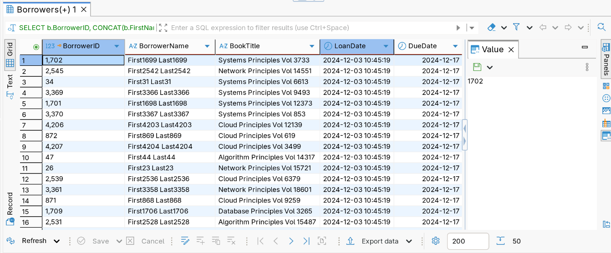

#### Borrowers Loan History
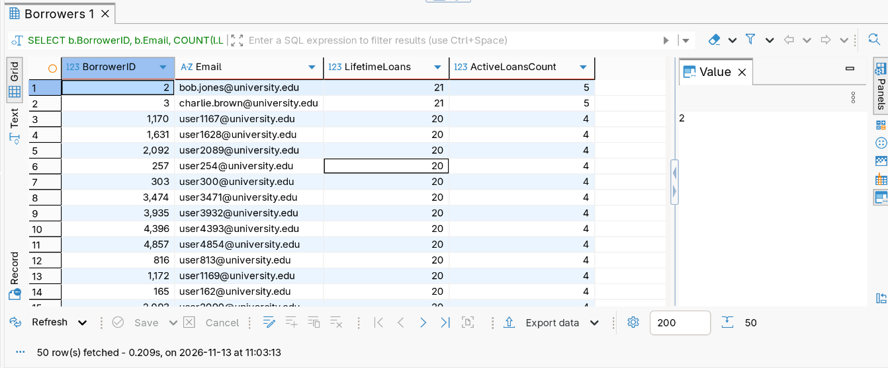

#### Bulk Data
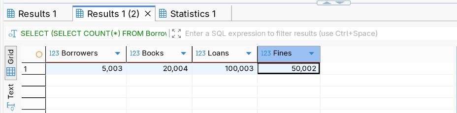

#### Category Popularity and Circulation Aggregation: Total loans per book.
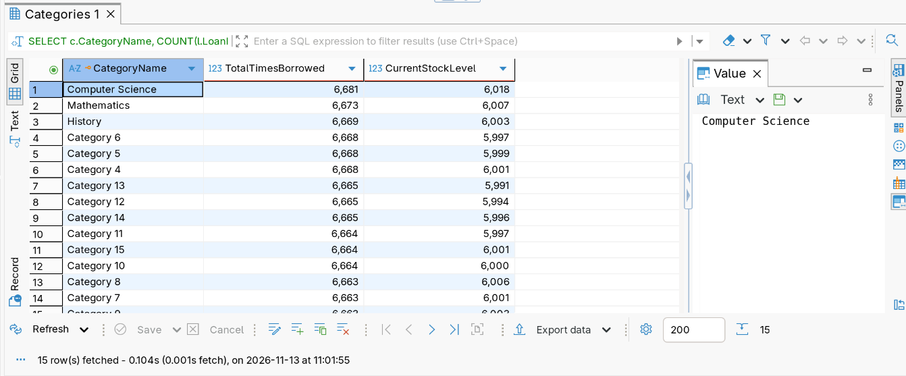

## 5. Performance Analysis
1. **Index Selection:** Single-column B-tree indexes on high-cardinality foreign keys (`BorrowerID`, `BookID`) combined with composite range indexes on operational attributes (`DueDate`, `Status`) provide optimal coverage for join operations and filter predicates.
2. **I/O Efficiency:** Utilizing secondary B-tree indexes allows the query engine to resolve predicates directly within index pages, reducing random disk I/O and buffer pool churn.

### 5.1 Indexes created

Internal query engine optimization metrics demonstrating key utilization (`idx_loans_borrower_status`, `ISBN`) and reduced row scans.   
The command below was run to create the indexes.  
`CREATE INDEX idx_loans_status_due ON Loans (Status, DueDate);`  
`CREATE INDEX idx_books_title ON Books (Title);`  
`CREATE INDEX idx_loans_borrower_status ON Loans (BorrowerID, Status);`

#### Default Indexes
- ##### Books
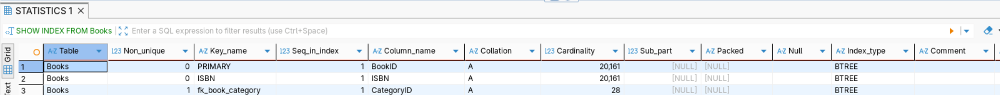
- ##### Loan
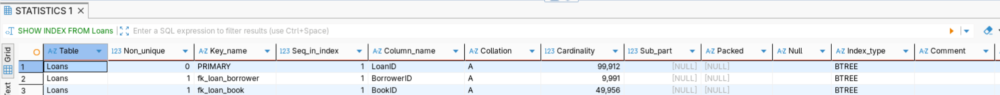
- ##### Fines
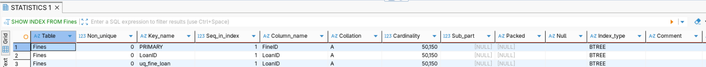

#### Indexes Created
- ##### Books
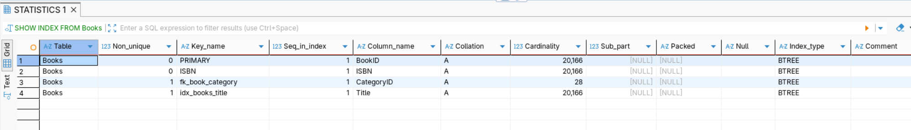
- ##### Loans
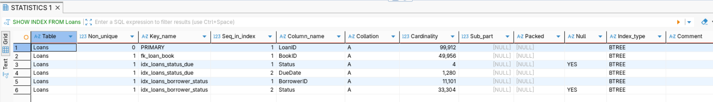
- ##### Fines
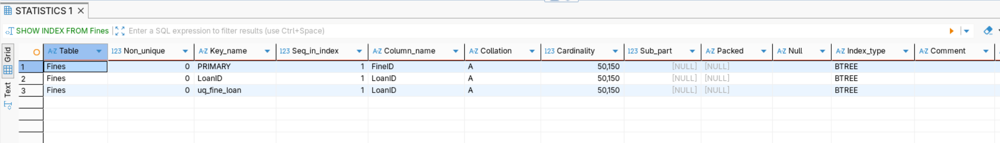

| Index | Query it serves | Reasoning |
|---|---|---|
| `idx_loans_status_due (Status, DueDate)` | Q-A: overdue more than 30 days | Equality column (`Status`) first, range column (`DueDate`) second; also covers the query (no table lookup) |
| `idx_books_title (Title)` | Q-B: `Title LIKE 'Database%'` | A B-tree supports prefix searches as a range scan |
| `idx_loans_borrower_status (BorrowerID, Status)` | Q-D: one member's open loans | Both predicates resolved in the index; expected to be a small gain only, because `BorrowerID` was already indexed |
| `idx_fines_ispaid (IsPaid)` | Q-F: unpaid fines | **Experiment:** a boolean has very low selectivity; documented to show the optimiser may ignore it |

The screenshot below shows that the indexes actually occupy a small space and as such are space efficient
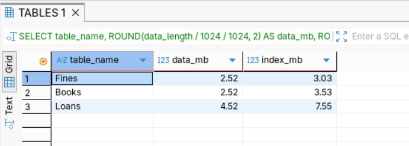

## 5.2 Results before and after Indexes were created for Optimization
Below shows the results of `ANALYZE` (actual rows and time), before and after the index, three runs each, median recorded. Performance benchmarks shows reduced execution overhead.

**Query A** (`ANALYZE SELECT COUNT(*) FROM Loans WHERE Status = 'Overdue' AND DueDate < CURRENT_DATE - INTERVAL 30 DAY;`)

##### Before Indexes were created:
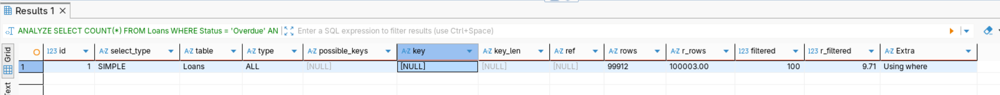

##### After Indexes were created: 
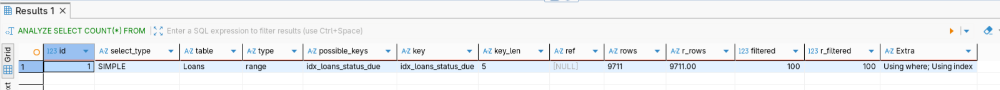

---
---

**Query B** (`ANALYZE SELECT BookID, Title FROM Books WHERE Title LIKE 'Database%';`)

##### Before Indexes were created:

##### After Indexes were created: 
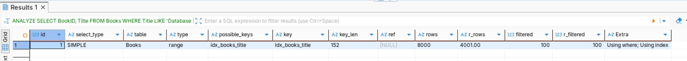

---
---

**Query C** (`ANALYZE SELECT BookID, Title FROM Books WHERE Title LIKE '%Principles%';`)

##### Before Indexes were created:
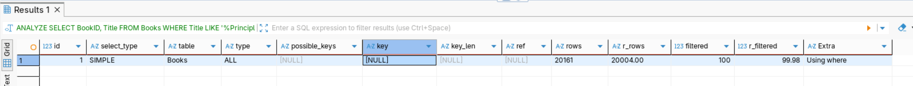

##### After Indexes were created: 
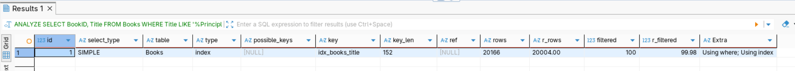

---
---

**Query D** (`ANALYZE SELECT * FROM Loans WHERE BorrowerID = 1234 AND Status = 'Borrowed';`)

##### Before Indexes were created:
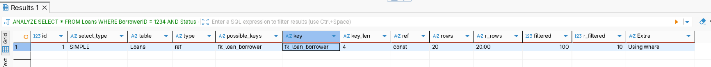

##### After Indexes were created: 
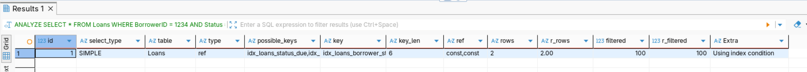

---
---

**Query E** (`ANALYZE SELECT * FROM Books WHERE ISBN = '9780001000100';`)

##### Before Indexes were created:
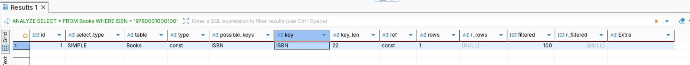

##### After Indexes were created: 
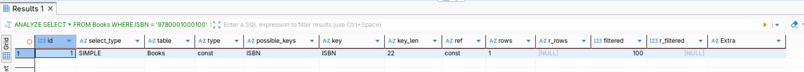

---
---

**Query F** (`ANALYZE SELECT l.BorrowerID, SUM(f.Amount) AS UnpaidTotal FROM Fines f JOIN Loans l ON l.LoanID = f.LoanID WHERE f.IsPaid = FALSE GROUP BY l.BorrowerID;`)

##### Before Indexes were created:
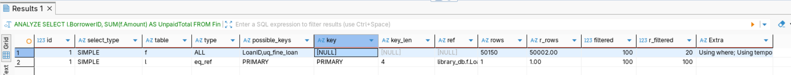

##### After Indexes were created: 
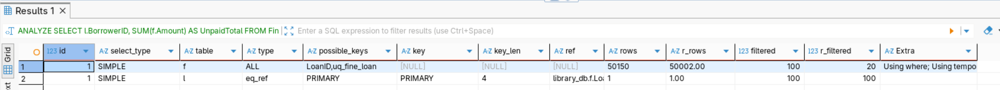

---

### 5.3 Results Summary

| Query | Before: type / key / rows | Before: time (ms) | After: type / key / rows | After: time (ms) |
|---|---|---|---|---|
| Q-A overdue > 30 days | ALL / NULL / 99912 |27 | range / idx_loans_status_due / 9711| 5 |
| Q-B title prefix |ALL / NULL / 20166 | 9 | range / idx_books_title / 8000 | 3 |
| Q-C title `%word%` (control) | ALL / NULL / 20166 | 11 | index / idx_books_title / 20161| 2 |
| Q-D member's open loans | ref / fk_loan_borrower / 20 | 2 | ref / idx_loans_borrower_status / 2 | … |
| Q-E ISBN lookup (control) | const / ISBN / 1 | 2 | const / ISBN / 1 | 1 |
| Q-F unpaid fines | ALL,eq_ref / NULL,PRIMARY / 48893,1 | 48 | ALL, eq_ref / NULL, PRIMARY. 50150,1 | 35 |

---

* **Q-A and Q-B** are the cases where an index should turn a full scan (`type = ALL`, rows ≈ table size) into a `range` scan examining a fraction of the rows.
* **Q-C and Q-E** are controls. Q-C should stay a full scan whatever index exists, and Q-E should stay `const` because the index was already there.
* **Q-D** should change little, which is a useful lesson: an extra index is not automatically an improvement.
* **Q-F** may keep its original plan. If the optimiser ignores `idx_fines_ispaid`, that is a valid finding and the index should be dropped.
