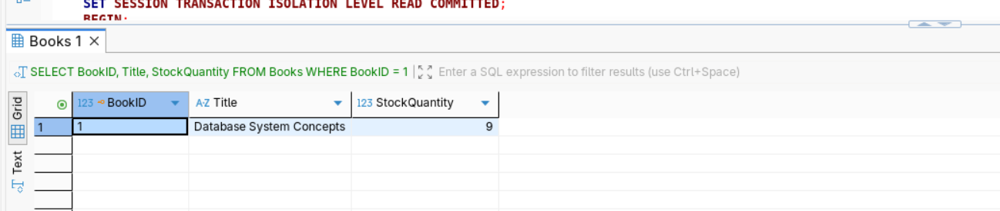
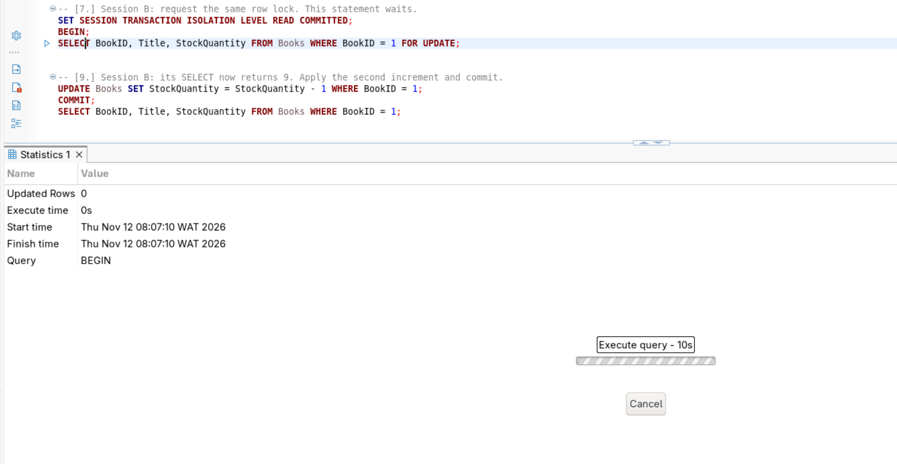
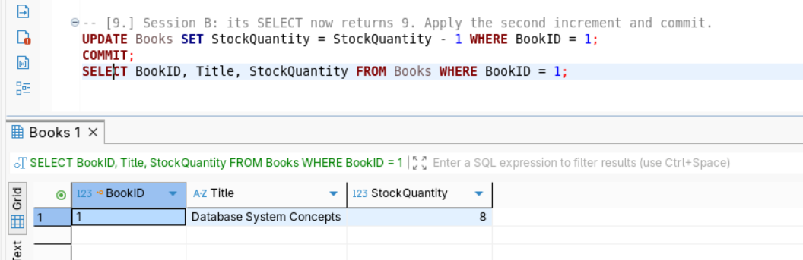

# Portfolio 3: Transactions and Concurrency Report

## 1. Overview
This module demonstrates transaction management and concurrency control within the Library Management System. To maintain data integrity across multi-step operations (such as book checkouts and fine settlements), rigorous use of **ACID** properties and isolation controls was applied.

## 2. ACID Implementation in the Library System
* **Atomicity:** Ensured through explicit transaction blocks (`START TRANSACTION`, `COMMIT`, `ROLLBACK`). For instance, a book checkout updates both the `Loans` table and the `Books` inventory simultaneously. If an error occurs, all changes are rolled back.
* **Consistency:** Enforced via primary keys, foreign key constraints, and check constraints (e.g., preventing negative stock levels or fine amounts).
* **Isolation:** Managed using database transaction isolation levels (e.g., `REPEATABLE READ`) to prevent dirty reads and non-repeatable reads during concurrent operations.
* **Durability:** Guaranteed by the database engine's write-ahead logging (WAL), ensuring committed transactions survive system failures.

## 3. Concurrency & Locking Mechanism
When multiple library members attempt to borrow the last available copy of a popular book simultaneously, race conditions can lead to inventory overselling. 
* By using **row-level exclusive locks** (`FOR UPDATE`), the database serializes access to the specific book record, ensuring that only one transaction can decrement the stock at a time while concurrent requests wait safely in queue.

##
The final SELECT query execution result grid in Session B shows the incorrect final stock count i.e 9 instead of 8 after two separate -1 decrements.

Session B wrote a stale value based on an outdated read.
##
The query is delaying to be executed

Session B is safely queued and blocked from reading/writing until Session A commits because row-level pessimistic locking (FOR UPDATE) by the RDBMS forces concurrent sessions to wait for active transactions to release locks.

##

The final SELECT query result grid in Session B showing the correct decremented stock value i.e 8 after both transactions completed sequentially.

Pessimistic locking successfully prevented the race condition, ensuring ACID compliance and data integrity. Once Session A committed (Step 8), Session B automatically unblocked, fetched the updated value, applied its increment/decrement cleanly, and maintained inventory consistency.

