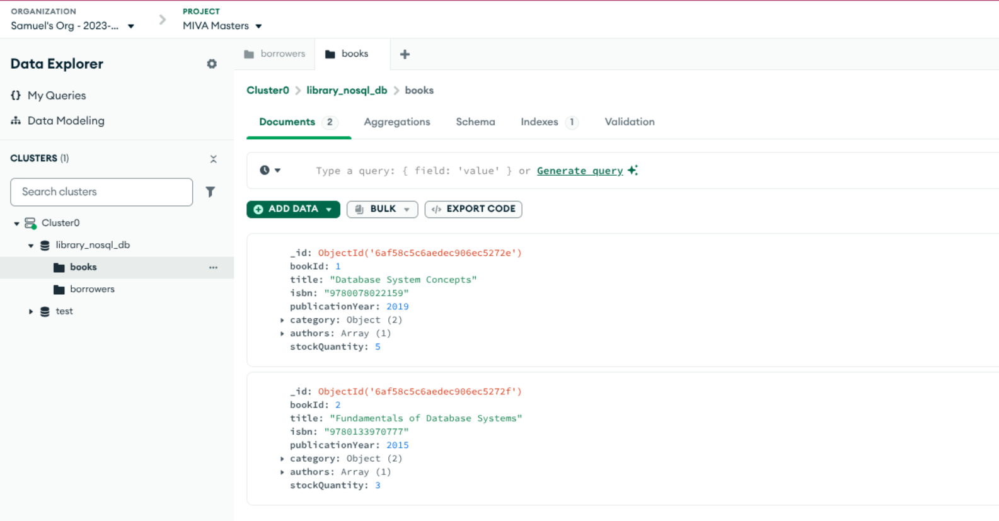
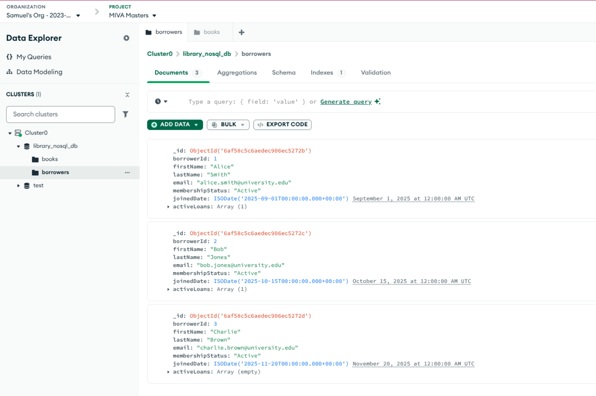
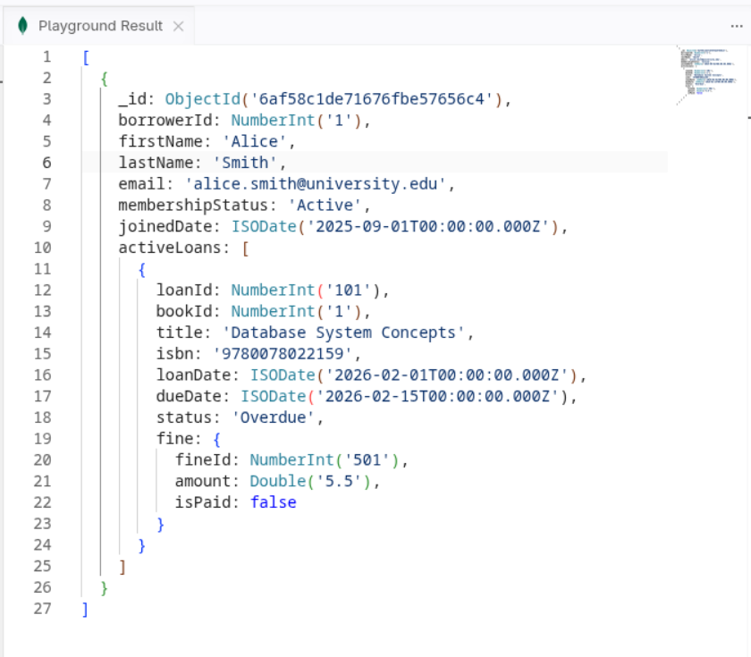
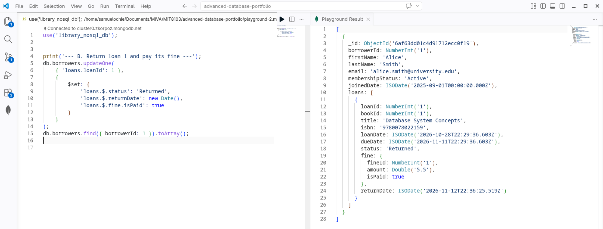
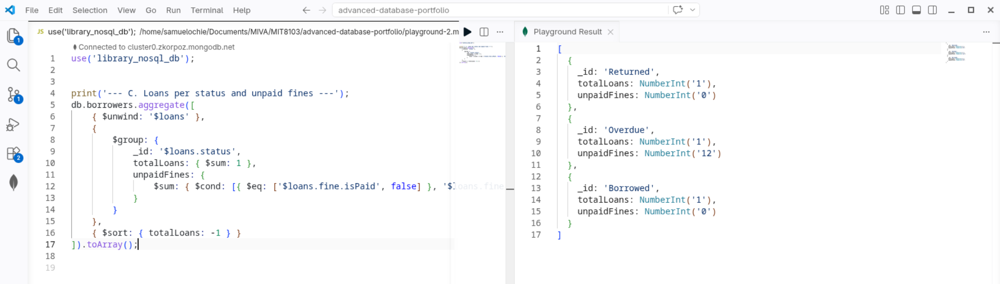

# Portfolio 4: NoSQL and Advanced Data Models Report

## 1. Overview
This module explores document-oriented database modeling using **MongoDB** for the Library Management System. While relational databases enforce strict normalization through tables and joins, NoSQL document stores allow related information to be grouped within flexible JSON documents.

## 2. Document Design Justification
- **Embedded Structures:** In the relational design (Portfolio 1), retrieving a borrower's active loans and fines required multi-table joins across `Borrowers`, `Loans`, and `Fines`. In MongoDB, active circulation data is **embedded** directly inside the `borrowers` collection array (`activeLoans`).
- **Performance Benefit:** Read operations for user profiles and active checkouts execute in a single disk lookup, eliminating join overhead for high-frequency user-facing queries.

## 3. Implemented Operations
- ### Document Creation (`insertMany`): Seeded collections for `borrowers` (with embedded loans/fines) and `books` (with embedded categories and authors).

- ### Targeted Filtering: Queried nested arrays to locate overdue books instantly.
  
  
*Query to show Overdue Books*

- ### Atomic Document Updates (`updateOne`): Updated nested loan and fine states using positional operators (`.$`).

*Query to Show successful update*

- ### Aggregation Framework: Used `$unwind` and `$group` pipelines to analyze loan distributions across membership categories.

  
*Query to show aggregation framework*

## 4. Architectural Suitability: SQL vs. NoSQL in an LMS
* **Read Performance & Scalability (NoSQL Strength):** Document models excel in user-facing dashboards and member portals. Fetching a member's complete profile, active loans, and fine status requires zero joins, resulting in fast single-document lookups ($O(1)$) and effortless horizontal scaling as catalog and user sizes expand.
* **ACID Compliance & Integrity Constraints (Relational Strength):** Relational databases (MariaDB) remain superior for core financial and inventory ledgering where strict foreign key enforcement, multi-table consistency, and bulletproof ACID transaction boundaries are mandatory to prevent negative inventory stock or orphaned records.