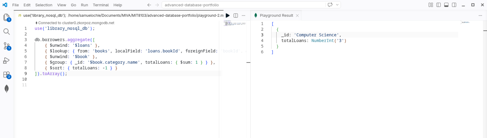
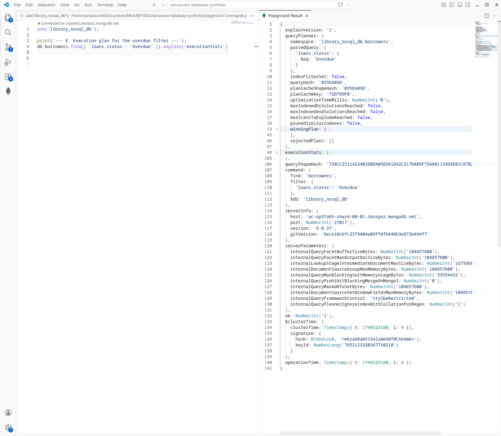

# Portfolio 4: NoSQL and Advanced Data Models Report

## 1. Overview
This module remodels the Library Management System as MongoDB **documents** (document store). The same data as the relational sample (3 borrowers, 4 books, loan ids 1-3, fine ids 1-2) is used, so the two models can be compared directly.

Source: `Ochie_Samuel_P4_MongoDB.js` (run in MongoDB Compass playground).

## 2. Document model

**`borrowers` collection**: one document per member, with the member's loans embedded as an array, and each loan's fine embedded in the loan.

```json
{
  "borrowerId": 1, "firstName": "Alice", "lastName": "Smith",
  "email": "alice.smith@university.edu", "membershipStatus": "Active",
  "loans": [ { "loanId": 1, "bookId": 1, "title": "Database System Concepts",
               "status": "Overdue", "fine": { "fineId": 1, "amount": 5.5, "isPaid": false } } ]
}
```

**`books` collection**: one document per book with its category and authors embedded (read-mostly catalogue data).

| Relational (Portfolio 1) | Document model |
|---|---|
| `Borrowers` + `Loans` + `Fines` (3 tables, 2 joins) | one `borrowers` document with `loans[].fine` |
| `Books` + `Categories` + `BookAuthors` + `Authors` (4 tables) | one `books` document with `category` and `authors[]` |
| `UNIQUE`, `CHECK`, ENUM | unique indexes and a `$jsonSchema` validator |

## 3. Implemented operations and evidence

| Step | What it does | Screenshot |
|---|---|---|
| Create, validate, index, insert | `createCollection` with `$jsonSchema` validator; unique indexes on email, ISBN, ids; multikey index on `loans.status`; `insertMany` |   |
| Query A | Find borrowers with an overdue loan using a nested-array filter |  |
| Query B | `updateOne` with positional operator `$`: return loan 1 and mark its fine paid |  |
| Query C | `$unwind` + `$group`: loans and unpaid fine total per loan status |  |
| Query D | `$lookup` across both collections: loans per category |  |
| Query E | `explain('executionStats')`: confirms an `IXSCAN` on `loans.status` | |

> The existing screenshots were taken from the earlier version of the script. Re-run the updated script and replace them so the images match the code (the array is now called `loans`, and Query C now groups by loan status).

## 4. Design decisions and trade-offs

**Why embed loans in the borrower?** A member's profile, loans and fines are read together on almost every screen, and one member has a bounded number of loans. One document read replaces two joins, and a single-document update is atomic in MongoDB.

**What embedding costs:**
* **Duplication.** Each loan copies the book `title` and `isbn`, and each book embeds the full category description. If a title is corrected, every copy must be updated, which the relational model avoids by storing it once. The copy is acceptable here because a loan record should show the title *as it was when borrowed*, but the category description is duplicated for convenience only.
* **Unbounded growth.** A member who borrows for decades would grow an ever larger document (the BSON limit is 16 MB). In production, closed loans would move to a separate `loanHistory` collection and only open loans would stay embedded (the "bucket"/archive pattern).
* **Cross-collection queries need `$lookup`** (Query D), which is the NoSQL counterpart of a join and is slower than an embedded read. Whole-library statistics, such as loans per category, are a poor fit for this model.
* **Consistency.** Decrementing `stockQuantity` in `books` and adding a loan in `borrowers` touch two documents. That needs a multi-document transaction (supported on replica sets) or careful ordering, which is why inventory stays in the relational database in the suitability recommendation below.

**Correction notes from the first version:** returned loans were being left in an array called `activeLoans`, which was misleading (the array is now `loans`); Query C grouped by `membershipStatus`, where every member was `Active`, so it showed nothing; the sample ids did not match the SQL ids.

## 5. Suitability: SQL vs NoSQL for this system

| Concern | Better fit | Reason |
|---|---|---|
| Member dashboard (profile, open loans, fines) | Document | One read, no joins |
| Catalogue browse and search | Document | Self-contained book documents scale reads easily |
| Stock levels, checkout, fine payment | Relational | Multi-row ACID transactions and foreign keys (Portfolio 3) |
| Library-wide reports | Relational | Joins and aggregation across all entities |
| Audit logs, notification history | Document | Append-heavy, flexible structure |

**Recommendation:** polyglot persistence. Keep the system of record (inventory, loans, fines) in MariaDB, and serve read-heavy member and catalogue views from MongoDB, kept in sync from the relational database.
