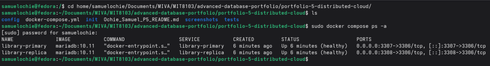
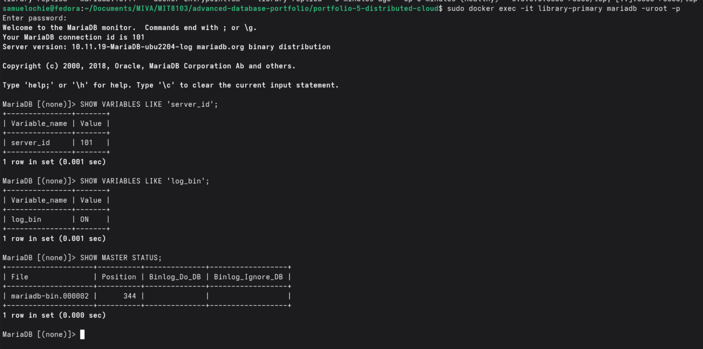
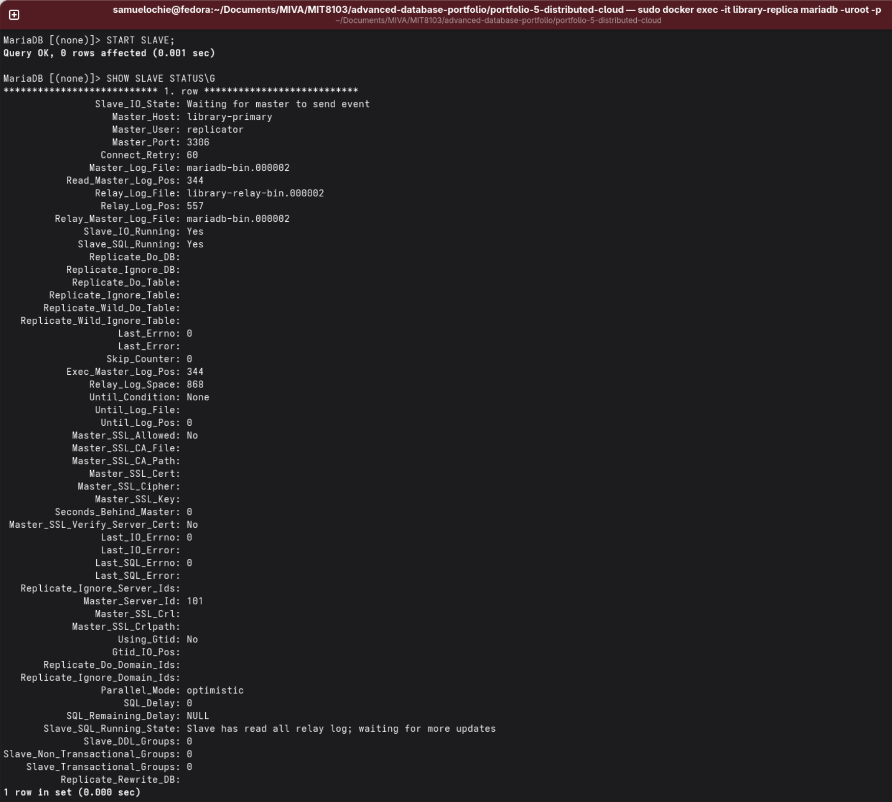
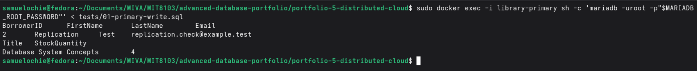
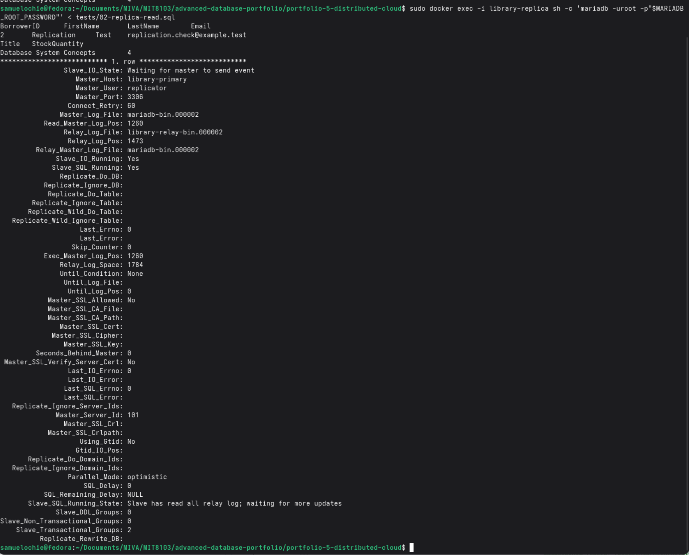
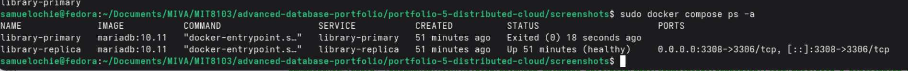
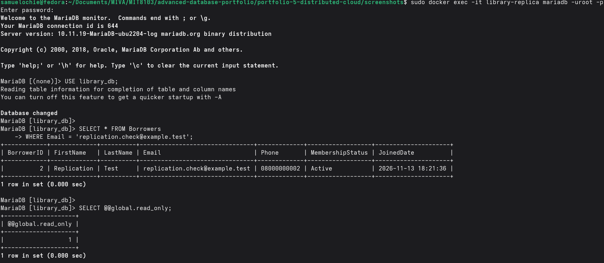
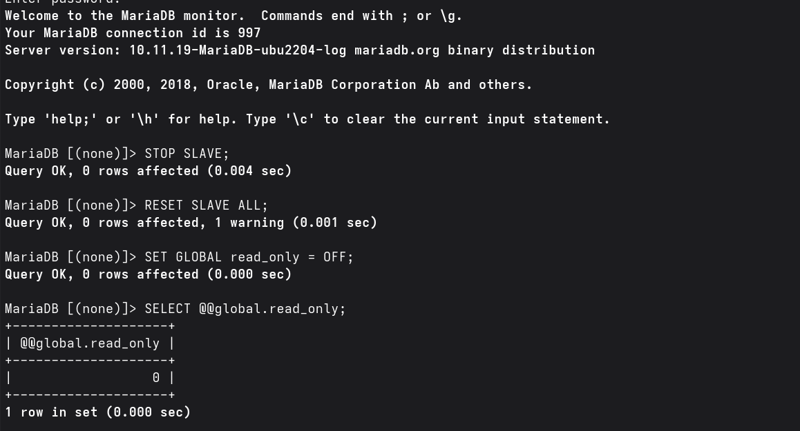
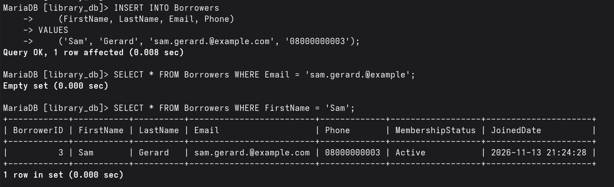

# Portfolio 5: Distributed and Cloud Database Exercise
## 1. Aim and scope

This exercise extends the relational Library Management System from Portfolio 1 into a two-node database topology. The primary node accepts application writes and records changes in its binary log. A separate replica reads that log and replays the changes. The replica is configured as read-only for ordinary application connections and can serve suitable read/reporting workloads.

The exercise demonstrates database deployment, asynchronous replication, read scaling, replication monitoring, consistency behaviour and a controlled manual promotion procedure. It is a local proof of concept, not a production cloud deployment. No AWS resources, multi-region failover, 99.99% availability, sub-50 ms latency or zero-data-loss guarantee are claimed by this implementation.

## 2. Architecture

```text
                    Application / SQL client
                       /              \
              WRITE /                  \ READ (after replication)
                    v                    v
          +----------------+    +----------------+
          | library-primary|    | library-replica|
          | MariaDB 10.11  |    | MariaDB 10.11  |
          | server_id=101  |    | server_id=102  |
          | Binary log     |    | Relay log      |
          | Read + write   |    | read_only=ON   |
          +-------+--------+    +--------^-------+
                  |                      |
                  +-- binlog stream -----+
                     asynchronous
                     replication
```

Both containers use separate persistent Docker volumes. Host ports are 3307 (primary) and 3308 (replica). Inside the Compose network, the replica reaches the primary using the service name `library-primary` and port 3306.

## 3. Files

- `docker-compose.yml` – defines the two MariaDB services, persistent volumes, health checks and port mappings.
- `config/primary.cnf` – enables the primary server ID and row-based binary logging.
- `config/replica.cnf` – assigns a different server ID, relay log and read-only setting.
- `init/ Ochie_Samuel_01-schema.sql` – creates the seven-table relational schema from Portfolio
- `init/ Ochie_Samuel_02-sample-data.sql` – inserts a small dataset for testing.
- `init/ Ochie_Samuel_03-replication-user.sql` – creates a dedicated replication account.
- `scripts/Ochie_Samuel_primary_write.sql` – contains SQL used to verify writes on the primary.
- `scripts/Ochie_Samuel_replica_read.sql` - contains SQL used to verify reads on the replica.
- `scripts/Ochie_Samuel_sql_commands.sql` - SQL commands for database initialization, binary logging, replication, verification, failure handling and manual promotion which is used for the MariaDB primary-replica exercise 
- `scripts/Ochie_Samuel_terminal_commands.sh` - terminal commands for docker, MariaDB container management, database backups, imports, testing and failure simulation.
- `.env` –  environment file for the local root password.
- `screenshots` - Captured images of the results 


## 4. Deployment and configuration

### Prerequisites

Install Docker Engine and the Docker Compose plugin. Confirm they are available

```bash
docker --version
docker compose version
```

### Start the two database nodes

From this directory:

```bash
docker compose up -d
docker compose ps
```

The schema and sample data are loaded automatically on the primary's first initialisation.




### Verify binary logging on the primary
Next, we need to confirm that the primary database is configured to record changes in its binary log. This is essential because the replica will use those logs to reproduce changes.

Connect to the primary  
```bash
sudo docker exec -it library-primary mariadb -uroot -p
```

At the MariaDB prompt, run:
```sql
HOW VARIABLES LIKE 'server_id';

SHOW VARIABLES LIKE 'log_bin';

SHOW MASTER STATUS;
```


This confirms that binary logging is active. The primary is recording database changes so that the replica can retrieve and replay them.

### Create a consistent seed copy for the replica

The replica must start with a copy of the primary database and the matching binary-log coordinates.
```bash
source .env
docker exec library-primary sh -c 'mariadb-dump -uroot -p"$MARIADB_ROOT_PASSWORD" --single-transaction --master-data=2 --databases library_db' > library_seed.sql
```


Inspect the dump and locate the commented `CHANGE MASTER TO` line:

```bash
grep -m1 'CHANGE MASTER TO' library_seed.sql
```

It contains the actual `MASTER_LOG_FILE` and `MASTER_LOG_POS` values for this running primary.

Import the seed into the replica:

```bash
docker exec -i library-replica sh -c 'mariadb -uroot -p"$MARIADB_ROOT_PASSWORD"' < library_seed.sql
```

Configure replication on the replica, replacing the file name and position with the values obtained from the dump:

```bash
docker exec -it library-replica mariadb -uroot -p
```

At the MariaDB prompt:

```sql
STOP SLAVE;
CHANGE MASTER TO
  MASTER_HOST='library-primary',
  MASTER_PORT=3306,
  MASTER_USER='replicator',
  MASTER_PASSWORD='Replica_ChangeMe!',
  MASTER_LOG_FILE='mariadb-bin.000001',
  MASTER_LOG_POS=1234;
START SLAVE;
SHOW SLAVE STATUS\G
```



## 5. Replication test

Run the write script against the primary:

```bash
source .env
docker exec -i library-primary sh -c 'mariadb -uroot -p"$MARIADB_ROOT_PASSWORD"' <tests/ Ochie_Samuel_01-primary-write.sql
```


Then run the read/verification script against the replica:

```bash
docker exec -i library-replica sh -c 'mariadb -uroot -p"$MARIADB_ROOT_PASSWORD"' < tests/ Ochie_Samuel_02-replica-read.sql
```

The borrower with email `replication.check@example.test` and the reduced stock quantity for ISBN `9780078022159` are visible on the replica.

## 6. Availability and failure behaviour

This topology removes the replica as a single point of read availability, but it does not provide automatic failover. If the replica stops, the primary can continue accepting writes; replica reads are unavailable until it returns and catches up. If the primary fails, writes are unavailable until an administrator promotes a sufficiently up-to-date replica and redirects clients.

For a controlled local demonstration only, after confirming the replica has caught up, stop the primary:

```bash
docker stop library-primary
```


Run the script to query the database

```sql
USE library_db;

SELECT * FROM Borrowers
WHERE Email = 'replication.check@example.test';
SELECT @@global.read_only;
```



The borrower record is still be accessible and read_only returns 1. This confirms two important things:
- Read availability: The replica can still serve queries when the primary is unavailable.
- Write protection: The replica remains read-only, preventing accidental writes while it is still configured as a replica.


Next, Promote the replica manually:

```bash
docker exec -it library-replica mariadb -uroot -p
```

Run this query in the SQL to Stop replication threads so that the replica stops attempting to communicate with the unavailable primary and then remove the stored primary connection details and replication relay-log information.

```sql
STOP SLAVE;
RESET SLAVE ALL;
```

Finally, Disable read-only mode so that the promoted replica can accept writes and verify the promotion.
```sql
SET GLOBAL read_only = OFF;
SELECT @@global.read_only;
```


The result `0`shows and test insert can now be performed on the promoted node. 

To test the insert, a new borrower would be inserted while still connected to the promoted replica. Execute:

```sql
INSERT INTO Borrowers (FirstName, LastName, Email, Phone) VALUES ('Sam', 'Gerard', 'sam.gerard.@example.com', '08000000003');

SELECT * FROM Borrowers WHERE FirstName = 'Sam';
```


This proves that the former replica can now accept and retrieve new records independently of the failed primary.

## 7. Sharding and partitioning design

The current executable deployment uses replication, not sharding. For a larger multi-campus library, a possible horizontal sharding key is `CampusID` or a stable hash of `BorrowerID`. Each shard would hold the borrower, loan and fine records assigned to its campus/hash range. A request routed by the shard key can be directed to one shard; global reports may need fan-out queries and aggregation across shards. Referential integrity across shards and rebalancing are additional operational challenges. The current seven-table schema has no `CampusID`, so this remains a proposed extension rather than an implemented feature.

## 8. Consistency and CAP considerations

MariaDB primary–replica replication here is asynchronous. A successful commit on the primary may not yet be present on the replica. A read routed immediately to the replica can therefore return stale data. Checkout, return and fine-payment transactions should read and write through the primary when read-after-write consistency is required. Catalogue and historical reporting queries can use the replica when a small replication delay is acceptable.

During a network partition, this design does not make both nodes independent writable primaries. The primary remains the write authority; the replica is not automatically promoted. This avoids routine multi-primary write conflicts but means writes may be unavailable during primary failure. The CAP discussion should therefore be tied to the actual deployment behaviour, not described as a simple switch that makes individual tables CP or AP.


## 9. Conclusion

The exercise deploys a two-node MariaDB primary–replica topology for the Library Management System. It demonstrates binary-log-based asynchronous replication, separate database instances, read-only replica configuration, replication monitoring and a manual failover procedure. It also identifies the consistency lag and operational trade-offs of this architecture. Sharding and multi-region cloud deployment are discussed as future extensions rather than presented as completed implementation.
